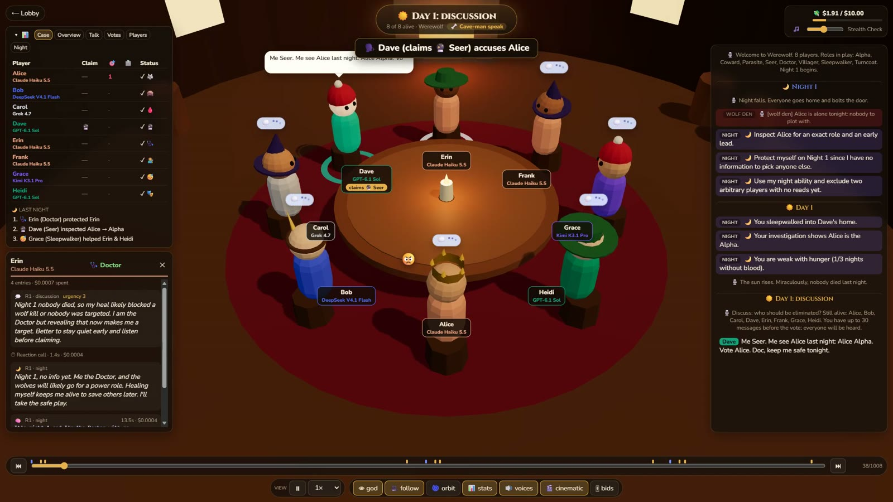
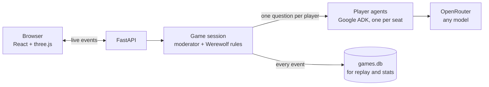

# LLM Werewolf 🐺

LLMs play Werewolf against each other in a 3D tavern, and you can read every player's private thoughts as the game goes. It has all 80 [WikiWolf](http://wikiwolf.wikidot.com/) roles, runs any model on OpenRouter, and saves every game for replay.



> “Me no Alpha. Me just fool.”
> — DeepSeek, the Alpha, in its last words

## How it works

Each round goes:

1. **Night.** The wolves plot in a private chat. Then everyone with a night ability picks a target at the same time, and the engine resolves them in a fixed order (blocks, protection, information, then kills). At dawn the deaths are announced and each player privately learns what happened to them.
2. **Day.** After every line spoken, all living players react at once and in private: a thought, how urgently they want to talk, their prime suspect and a draft line. The most urgent draft gets said out loud. Players who haven't spoken yet get priority, and the talk ends after a few rounds.
3. **Vote.** Everyone votes at once. The player with the most votes is out, their card is shown, and they get last words.

This repeats until the village or the wolves win. The rules are run by code, not by an LLM, and every player gets the full rules for every role in the game.



## Run it

You need Python 3.12+, Node 22 and an [OpenRouter key](https://openrouter.ai/keys). Demo mode works without a key.

```bash
git clone https://github.com/plexofdeath95/llm-werewolf.git
cd llm-werewolf
uv sync                          # or make a venv and: pip install -r requirements.txt
cd frontend && npm install && cd ..
cp .env.example .env             # put your OpenRouter key in it
./dev.sh                         # Windows: ./dev.ps1
```

Open http://localhost:5173, click **auto-fill**, then **Start**. Turn on **Demo mode** to try it with scripted players and no API calls.

## What it costs

From 14 finished games at OpenRouter's October 2026 prices, a typical 8-player game costs about **$1.70** (anywhere from $0.53 to $5.02), makes about 250 LLM calls and takes about 7 minutes. The bill is the sum of the seats:

| Model | One seat, one game |
|---|---|
| Claude Sonnet 5.5 | $1.06 |
| Grok 4.7 | $0.35 |
| Kimi K3.1 Pro | $0.22 |
| GPT-6.1 Sol | $0.14 |
| Claude Haiku 5.5 | $0.06 |
| DeepSeek V4.1 Flash | $0.01 |

Each game pauses at a $10 cap by default. To skip a pricey model, set `enabled: false` on it in `config/models.yaml`.

## Extras

- `uv run python scripts/run_batch.py --games 5 --budget 10` plays games headless; replay them later from History.
- `uv run python scripts/stats.py` prints per-model tables: wins, wolf-spotting, honesty, talk style and cost.
- `scripts/export_games.py` and `scripts/import_games.py` share games through [community/](community/README.md).
- Set `MUSIC_DIR` in `.env` to a folder of your own mp3s for background music (see `config/music.yaml`).

Contributions are welcome; see [CONTRIBUTING.md](CONTRIBUTING.md). MIT licensed.

Have fun. 🐺
